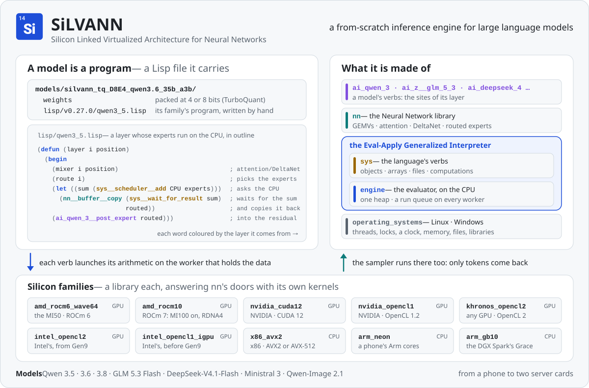

# SiLVANN

> **Developer preview, v0.29.0.** It runs the models below well on the hardware it was tested on, and it is shared
> for people who can find their way around a build and a stack trace. NVIDIA cards are tested on five, a GeForce
> RTX 5060 Ti and an RTX 5070 Ti, an A100, an H100 and a B200; Windows natively on one PC; macOS is not supported.

<picture>
  <source media="(prefers-color-scheme: dark)" srcset="docs/images/silvann_dark.svg">
  
</picture>

**Silicon Linked Virtualized Architecture for Neural Networks** — a from-scratch inference engine for large language
models, and the three things it is made of:

- **a virtualized architecture, as the JVM is one** — the Eval-Apply Generalized Interpreter: a machine of its own, run
  over the host's. Its programs are written in a small Lisp and evaluated on the CPU, which hands their arithmetic to
  whichever silicon holds the data. It keeps its own heap of reference-counted objects and a run queue on every worker —
  a CPU socket, a graphics card — and a program hands work to a worker with the answer that work will fill. Its
  multitasking is **preemptive, but not protected**: a computation gives its worker up, at the end of a verb, once it
  has run 50 ms and something else waits there (the slice every machine boots with; booted with none, a step runs until
  it ends or queues the step that continues it); a computation waiting on an answer not there yet is parked, and its
  worker runs other work until it fills; an idle worker sleeps until work is queued for it; a process can be killed, its
  queued work answered with an error. Not protected: a verb runs to its end, and every program shares one heap. Of the
  host it asks only primitive calls — threads, locks and conditions, a clock, memory, files, and opening a library: a
  silicon family is such a library, wrapping a driver's functions (HIP, CUDA, OpenCL) or the CPU's vector units —
  answered for Linux and for Windows in one file each;
- **its language's verbs** (`sys`) — what a program says to that machine: names and environments, objects, arrays and
  lists, a dictionary, files, and computations — handed to a worker, waited on, moved to another worker, run without
  being preempted, killed;
- **the Neural Network library** (`nn`) — the arithmetic, the memory structures and the words a model is written in.

A model is a program in that language (`engine/src/packages/ai_qwen_3`, `engine/src/packages/ai_z__glm_5_3`), and the
weights are packed with TurboQuant: rotated rows at 4 or 8 bits, so a 35-billion-parameter model fits in 19 GB.

Nothing in the language or its operating system knows about neural networks: `nn` is a package written on top of them,
and they stand on their own (`engine/src/packages/sys/README.md`). Python hosts the engine today — the runtime that loads
a model, the chat and the server — through the engine's C interface, which a program in any language can call.

## Models, and what they run on

The model for each kind of machine, from no card to two server cards — the card, the RAM, the CPU and the disk it was
measured on, how fast it reads a prompt and answers after one:

<!-- rates:readme -->
| GPU | RAM | CPU | Disk | Model | Setup | Prefill | Decode | Max context |
|---|---|---|---|---|---|---|---|---|
| [a phone](docs/android.md) | 5.4 GB | 8 Arm cores | — | [Qwen 3.5 2B](docs/models.md#qwen-35-2b) `D4` | Android (Termux), experimental | 15.2-15.9 positions/s | 8.02-9.60 tokens/s after 163 | — |
| [none](docs/results.md#no-graphics-card) | 16 GB | 4 cores | — | [Qwen 3.5 4B](docs/models.md#qwen-35-4b) `D4` | the CPU alone | 18.9 positions/s | 7.95 tokens/s after 8k | 8,320 |
| [8 GB](docs/results.md#an-8-gb-card) | 32 GB | 4 cores | — | [Qwen 3.6 35B-A3B](docs/models.md#qwen-36-35b-a3b) `D8E4` | the experts in RAM, a tier on the card | 94.9 positions/s | 14.34 tokens/s after 100k | 262,144 |
| [16 GB](docs/results.md#a-16-gb-card) | 32 GB | 4 cores | NVMe, 5.7 GB/s | [Qwen 3.8 Flash-Next](docs/models.md#qwen-38-flash-next) `D8E4` | the experts from the disk | 29.2-29.4 positions/s | 10.61-10.64 tokens/s after 2k | — |
| [16 GB](docs/results.md#a-16-gb-card) | 14 GB | 4 cores | NVMe, 5.7 GB/s | [GLM 5.3 Flash](docs/models.md#glm-53-flash) `D8E4` | the experts from the disk | 9.1 positions/s | 2.21 tokens/s after 100k | 110,000 |
| [16 GB](docs/results.md#a-16-gb-card) | 16 GB | 4 cores | — | [Qwen 3.8 27B](docs/models.md#qwen-38-27b) `D4` | on the card | 221.3 positions/s | 14.32 tokens/s after 35k | 35,840 |
| [2× 16 GB](docs/results.md#two-cards-or-more) | 125 GB | 28 cores | — | [Qwen 3.6 35B-A3B](docs/models.md#qwen-36-35b-a3b) `D8E4` | every layer over both cards, a tier on each | 85.9 positions/s | 32.22 tokens/s after 100k | 262,144 |
| [32 GB](docs/results.md#a-24-or-32-gb-card) | 160 GB | 28 cores | — | [GLM 5.3 Flash](docs/models.md#glm-53-flash) `D8E4` | every expert in RAM, a tier on the card | 72.1 positions/s | 9.86 tokens/s after 100k | 1,048,576 |
| [32 GB](docs/results.md#a-24-or-32-gb-card) | 1.5 TB (PMem 100) | 48 cores | — | [DeepSeek-V4.1-Flash](docs/models.md#deepseek-v41-flash) `D8E4` | every expert in RAM, a CPU worker a socket | 27.6-29.5 positions/s | 10.9-11.6 tokens/s after 2k | 2,320 as run |
<!-- /rates -->

Several conversations at once are served too (`multi_user` "yes") by the Qwen MoE models, Qwen 3.8 Flash-Next, GLM 5.3
Flash and DeepSeek-V4.1-Flash, usually at around 1.6-1.8× one conversation's tokens a second together, and about 2× for the
35B and Flash-Next on two cards, each card a tier of its own — each model's, and on which machine, in
[`docs/results.md`](docs/results.md#several-conversations-at-once).

Every model measured on each kind of machine, and how: [`docs/results.md`](docs/results.md#which-model-for-your-machine);
every machine one model was measured on, its packs and its notes: [`docs/models.md`](docs/models.md). A model whose config
names no setup chooses its own when the server starts, by trying it on the card: where its experts go, how much of the
card holds the ones used most, the context the card has room for ([`docs/config.md`](docs/config.md)).

**New in v0.29.0**, and in every release before it: [`docs/release_logs/v0.md`](docs/release_logs/v0.md).

## Platforms

- **Runs on:** Linux with an AMD card (ROCm 6 for the MI50, ROCm 7 or later from the MI100 on and for the Radeons of
  RDNA4), an NVIDIA card (CUDA 12)
  or OpenCL, or the CPU alone (AVX2 or
  AVX-512); Windows with an NVIDIA card; and, experimentally, an Android phone's Arm cores
  ([`docs/android.md`](docs/android.md)). Each machine it was measured on is in the table above.
- **Not yet tested:** AMD's MI100, MI200s and MI300s and the Radeons before RDNA3 (RDNA3 has run through OpenCL 2.0);
  NVIDIA's B300, and its cards before Pascal; Intel's GPUs and other integrated GPUs; Windows' prebuilt libraries.
- **Not supported:** macOS.

In full — what was checked on each, and what is not yet: [`docs/platforms.md`](docs/platforms.md).

Pictures and videos are read by the Qwen models and GLM 5.3 Flash (v0.7.0: [`docs/release_logs/v0.md`](docs/release_logs/v0.md#v070)), pictures by DeepSeek-V4.1-Flash (v0.17.0: [`docs/users.md`](docs/users.md#3-serve-it-and-chat)); Ministral 3 reads neither.
Every model calls the tool, a Lisp REPL on the machine, in its own trained format (v0.9.0: [`docs/users.md`](docs/users.md#the-models-tool)).
Pictures are made from a prompt by Qwen-Image 2.1, a server's model of its own (v0.10.0: [`docs/users.md`](docs/users.md#a-picture-model-qwen-image-21)).
A model's tool draws with the picture model, opens subagents and keeps skills of its own; a dense Qwen model's layers split over AMD cards (v0.11.0: [`docs/tools.md`](docs/tools.md), [`docs/config.md`](docs/config.md)).

## Quick start

Three ways in; each ends with the chat in your browser.

### Linux: a container (recommended)

```bash
curl -fsSL https://raw.githubusercontent.com/eval-apply-labs/SiLVANN/HEAD/docker/setup.sh | bash
```

Where there is no `curl` (Debian's netinstall has only `wget`): `wget -qO- https://raw.githubusercontent.com/eval-apply-labs/SiLVANN/HEAD/docker/setup.sh | bash`.

It sets SiLVANN up in a rootless container for your card — AMD, NVIDIA, or none — says what the machine is missing if
anything is, asks for a Brave Search API key so the model can search the web (Enter skips it), and starts it. Then open
the address it prints — http://silvann.localhost:8080, or the next free port where 8080 is taken: in **Options**,
**Download models** fetches a model and **start** runs it ([`docs/ui.md`](docs/ui.md)). To read MP4 and other video
files, run [`docker/install_nonfree.sh`](docker/README.md#set-it-up) once after it. In the container the model's tool reaches one folder of yours, `~/SiLVANN` — the models,
the conversations, and the workspace where you put what it should read — and nothing else of the machine
([why](docs/local_ai.md#container-first)). Updating, stopping, and the commands by hand:
[`docker/README.md`](docker/README.md).

### Windows: the portable app

No installer and no command line: from the [latest release](https://github.com/eval-apply-labs/SiLVANN/releases/latest),
download `silvann_portable_windows_x64.zip`, unzip it anywhere — a folder of yours, a USB drive — and double-click
`SiLVANN.exe` in it. The chat opens in a window of its own; in **Options**, **Download models** fetches a model and
**start** runs it. The folder carries its own Python and the libraries for every card the families list, so a card
needs only its driver, and without one the CPU runs the models. Its models and conversations stay in its `data\` folder;
closing the window saves them and ends everything it started
([`docs/users.md`](docs/users.md#on-windows-the-portable-app)). Smart App Control refuses it as it refuses the
installer's libraries (below).

### Windows: the installer

You need Python 3.11 to 3.14, Git and your card's driver; if Python or Git is missing, `winget install -e --id
Python.Python.3.12` and `winget install -e --id Git.Git`, then open a new PowerShell. In PowerShell, in the folder
SiLVANN should go under:

```powershell
curl.exe -fsSLO https://raw.githubusercontent.com/eval-apply-labs/SiLVANN/HEAD/install.ps1
powershell -ExecutionPolicy Bypass -File .\install.ps1
```

Then, in a new PowerShell (the `silvann` command is on the path from there), `silvann ui`: the chat opens at
http://localhost:8090, and in **Options**, **Download models** fetches a model and **start** runs it. To update,
`silvann update`; the models and the conversations stay.

Where Windows 11's Smart App Control is on, it refuses the libraries GitHub built, which are not signed yet; a proper
code signature is underway. Libraries built on the PC are subject to Smart App Control's lottery — some PCs let them
load, others do not — and anyone who wants to play it meanwhile can: `.\install.ps1 -FromSource` builds them on the
PC, with Visual Studio's Build Tools and their Clang tools, and CUDA's toolkit for an NVIDIA card
([`docs/users.md`](docs/users.md#on-windows), which has the line that installs them).
On Windows the model's shell starts switched off ([`docs/tools.md`](docs/tools.md#where-the-models-commands-reach)).

### Linux, from source

One line builds SiLVANN in `./silvann` for this machine's CPU and card, installs nothing system-wide, asks for no
password, and leaves a `silvann` command; `silvann ui` then opens the chat at http://localhost:8090, where **Options**
downloads a model and starts it:

```bash
curl -fsSL https://raw.githubusercontent.com/eval-apply-labs/SiLVANN/HEAD/install.sh | bash
silvann ui
```

`silvann help` lists the rest; `silvann update` updates, and the models and the conversations stay. The compilers a
card needs, building by hand, and keeping the models on another drive: [`docs/users.md`](docs/users.md).

### If you get stuck

An AI assistant can walk you through it. Paste this into one:

```text
Help me install SiLVANN, a program that runs large language models on my own machine. Read its instructions first:
https://raw.githubusercontent.com/eval-apply-labs/SiLVANN/HEAD/README.md and, on Linux,
https://raw.githubusercontent.com/eval-apply-labs/SiLVANN/HEAD/docker/README.md. Then ask me to run these commands one
at a time and paste what they print, and from what they show tell me what to do next, using only the commands in those
instructions and saying what each one does before I run it:
uname -a; cat /etc/os-release; podman --version; docker --version; nvidia-smi -L; ls /dev/kfd; id -nG; free -g
```

### Where to read on

- Every setting a model boots with, and each model's options: [`docs/config.md`](docs/config.md).
- The model's tool, and adding your own commands to it: [`docs/tools.md`](docs/tools.md).
- The experts read from the disk, and a model split over several machines: [`docs/users.md`](docs/users.md).
- Every measurement: [`docs/results.md`](docs/results.md).
- How it is built, and how a model or a silicon is added: [`docs/developers.md`](docs/developers.md).
- The ideas behind the design, the Lisp lineage and the model as a collapse of meaning:
  [`docs/concepts.md`](docs/concepts.md); how the weights are packed: [`docs/compression.md`](docs/compression.md).
- Where the design could go next: [`docs/directions.md`](docs/directions.md).
- Why a model on your own machine matters: [`docs/local_ai.md`](docs/local_ai.md).

## What is here

```
install.sh          fetches, builds and installs the `silvann` command — the one-line install on Linux
install.ps1         the same on Windows, with the libraries the release was built with
scripts/            build.sh, build.py — the engine built into lib/, on Linux, on Windows; build.ps1 the libraries
                    built on a PC; requirements*.txt the Python packages; install_nonfree.ps1 PyAV on Windows
docker/             a Dockerfile, for a container of your own — no image is published
engine/src/         the interpreter (engine, sys), the library (nn), the models (ai_qwen_3, ai_z__glm_5_3, ai_qwen_image,
                    ai_deepseek_4), silicon_families/ — one folder a kind of silicon, what it answers for the library —
                    and operating_systems/ — one folder a system, what it answers for the engine
runtime/            the Python side: a model folder booted onto the machine, conversations, the chat framing
lisp/               each model family's program, in Lisp — a model folder carries its family's in its own lisp/, a folder
                    for each release that changed it
silvann_core.py     download-model · check-model · list-models · hf-token
start_silvann_server.py, silvann_ui.py, silvann_cli.py     the server, the chat in a browser, the chat in a terminal
models/             where downloaded models go
skills/             commands for the model's tool, a folder each — docs/tools.md says how to add yours
docs/               users.md — running it; ui.md — the chat in the browser; config.md — a model's settings; tools.md — the model's tool and your own
                    commands; models.md — every model and what it needs; results.md — every measurement;
                    developers.md — how it is built, adding a model or a silicon;
                    concepts.md — the ideas behind it; compression.md — how the weights are packed;
                    directions.md — where it could go; local_ai.md — why AI on your own machine;
                    release_logs/v0.md — what each 0.x release brought, newest first
```

## Contact

Questions, ideas and results from your own machine go in this repository's **Discussions** tab; bugs go in
**Issues**. For anything you would rather not post in public, write to **admin@evalapply.co.uk**.

## Contributing

Reports from hardware we have not tried, bug reports and fixes are all welcome — see `CONTRIBUTING.md`. Pull
requests are made under the Contributor License Agreement in `CLA.md`, which a bot asks you to accept once.

## Licence

The engine is AGPL-3.0 (`LICENSE`), with an additional permission to convey it linked with NVIDIA's CUDA runtime
(`ATTRIBUTION.md` §1). Third-party notices are in `ATTRIBUTION.md`, an image built from `docker/`'s (§6) and the prebuilt Windows
libraries' (§7) among them. The model weights
keep their authors' licences.
